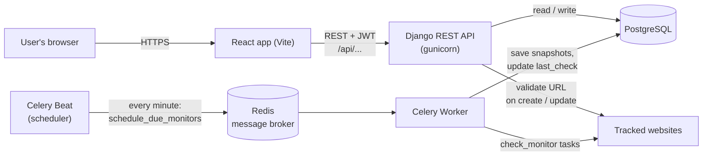
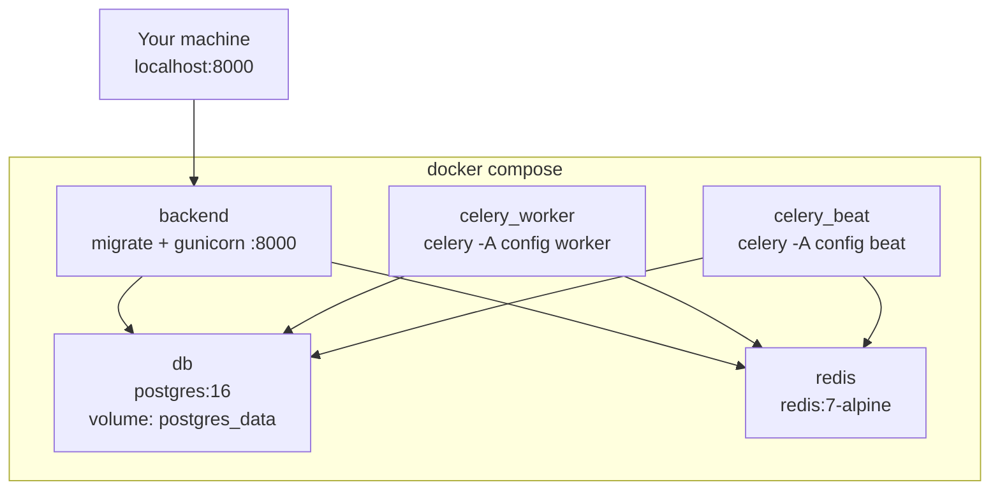
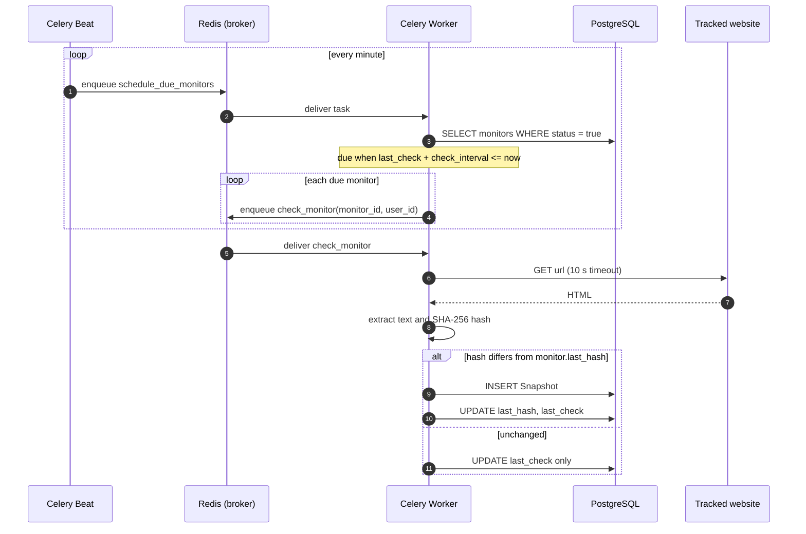
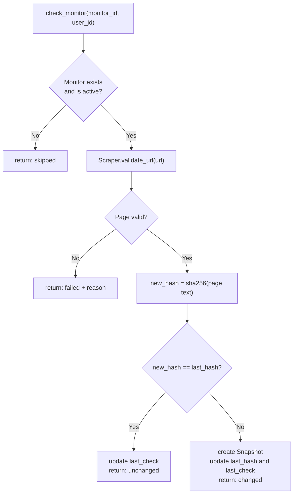
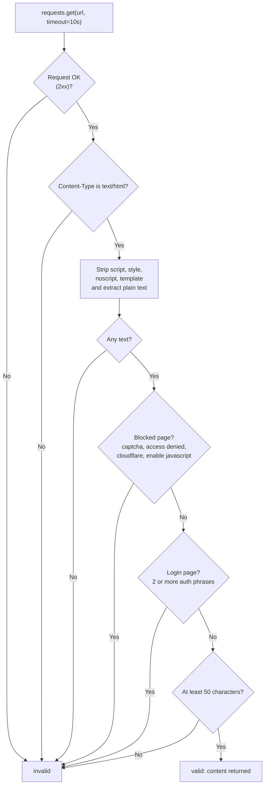
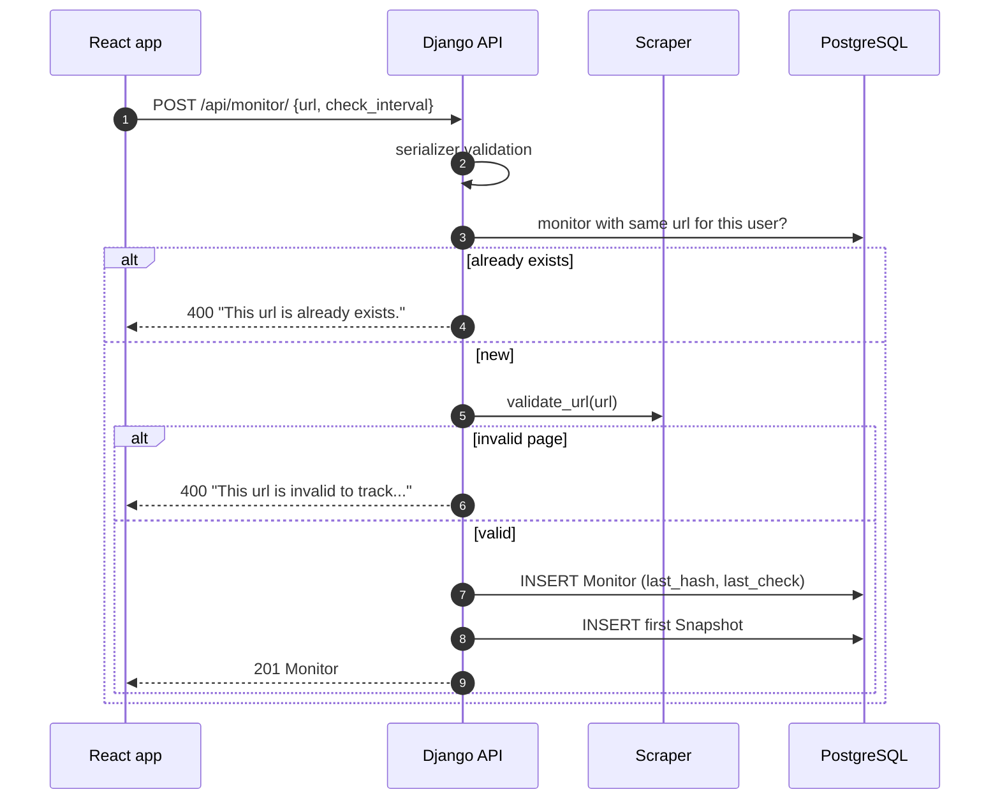
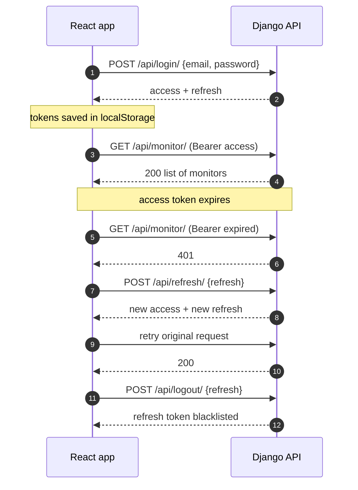
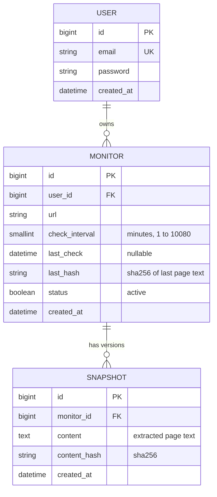
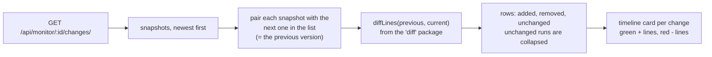

# Trackly

**Trackly watches web pages for you and shows exactly what changed.**

Paste a URL, pick how often it should be checked, and Trackly will fetch the page on a schedule, keep a
version of its text every time it changes, and show you a line‑by‑line diff (green = added, red = removed)
between versions.

- **Backend:** Django + Django REST Framework, JWT auth, PostgreSQL
- **Background jobs:** Celery + Celery Beat with Redis as the broker
- **Frontend:** React (Vite) single‑page app
- **Deployment:** Docker Compose (db, redis, api, worker, beat)

---

## Table of contents

1. [Features](#features)
2. [Architecture](#architecture)
3. [How a URL is checked (Celery)](#how-a-url-is-checked-celery)
4. [Authentication flow](#authentication-flow)
5. [Database](#database)
6. [REST API](#rest-api)
7. [Frontend](#frontend)
8. [Project structure](#project-structure)
9. [Configuration (.env)](#configuration-env)
10. [Running the project](#running-the-project)
11. [Tests](#tests)
12. [Roadmap](#roadmap)

---

## Features

- Register / log in with email and password (JWT access + refresh tokens, refresh tokens are rotated and blacklisted)
- Track any public HTML page and choose the check frequency (1 minute up to 7 days)
- The page is validated before it is saved: it must respond with HTML, contain real text, and must not be a
  captcha, "access denied" or login page
- Duplicate URLs are rejected per user
- Every time the page text changes, a new **snapshot** is stored
- Change history page with a diff between each snapshot and the one before it
- Rate limiting on register, login and the rest of the API

---

## Architecture

The system has five runtime parts. The API never scrapes pages during scheduled checks – that work is
pushed to Celery so the API stays fast.



### Docker Compose services

`docker-compose.yml` starts five containers that all share the same `backend/.env` file.



| Service         | Image / build       | What it does                                                      |
| --------------- | ------------------- | ----------------------------------------------------------------- |
| `db`            | `postgres:16`       | Stores users, monitors and snapshots (data kept in a volume)      |
| `redis`         | `redis:7-alpine`    | Message broker and result backend for Celery                      |
| `backend`       | `./backend`         | Runs migrations, then serves the API with gunicorn on port `8000` |
| `celery_worker` | `./backend`         | Executes the page‑check tasks                                     |
| `celery_beat`   | `./backend`         | Triggers `schedule_due_monitors` every minute                     |

---

## How a URL is checked (Celery)

Celery Beat fires **one** task every minute. That task decides which monitors are due and hands each of them
to the worker as its own small task, so slow websites never block each other.



### What happens inside `check_monitor`



### Page validation (`services/scraper.py`)

The same validator runs when you add a URL and on every scheduled check.



### Adding a URL (`POST /api/monitor/`)



---

## Authentication flow

Trackly uses JWT through `djangorestframework-simplejwt`.

| Token   | Lifetime   | Notes                                                    |
| ------- | ---------- | -------------------------------------------------------- |
| access  | 120 minutes | Sent as `Authorization: Bearer <token>`                 |
| refresh | 7 days     | Rotated on every refresh; the old one is blacklisted     |



If the refresh token is also invalid or expired, the frontend clears the tokens and sends the user back to
the login page.

---

## Database

PostgreSQL, three tables. Deleting a user deletes their monitors, and deleting a monitor deletes its snapshots
(`ON DELETE CASCADE`).



- A **Snapshot** is only created when the page text actually changes (the first one is created when you add the URL).
- `last_hash` on the monitor is a cache of the newest snapshot's hash, so a check only needs one comparison.

---

## REST API

Base path: `/api/`. All endpoints send and receive JSON. Everything except register, login and refresh needs
`Authorization: Bearer <access_token>`.

### Auth

| Method | Endpoint        | Body                  | Success                                        |
| ------ | --------------- | --------------------- | ---------------------------------------------- |
| POST   | `/register/`    | `email`, `password`   | `201` `{ access, refresh }`                    |
| POST   | `/login/`       | `email`, `password`   | `200` `{ message, access, refresh }`           |
| POST   | `/refresh/`     | `refresh`             | `200` `{ message, access, refresh }`           |
| POST   | `/logout/`      | `refresh`             | `200` `{ message }` (token is blacklisted)     |

Errors: `400` validation (for example a weak password or an email that is already registered), `401` wrong
credentials, `429` too many requests.

### Monitors

| Method | Endpoint                    | Body                                | Success                              |
| ------ | --------------------------- | ----------------------------------- | ------------------------------------ |
| GET    | `/monitor/`                 | –                                   | `200` list, newest first             |
| POST   | `/monitor/`                 | `url`, `check_interval` (minutes)   | `201` the new monitor                |
| GET    | `/monitor/<id>/`            | –                                   | `200` monitor                        |
| PATCH  | `/monitor/<id>/`            | `url` and/or `check_interval`       | `200` updated monitor                |
| DELETE | `/monitor/<id>/`            | –                                   | `204`                                |
| GET    | `/monitor/<id>/changes/`    | –                                   | `200` list of snapshots, newest first |

Users can only see and edit their own monitors (other users' ids return `404`).

Example monitor:

```json
{
  "id": 12,
  "user": 3,
  "url": "https://example.com/pricing",
  "check_interval": 60,
  "last_check": "2026-10-10T06:30:00Z",
  "last_hash": "9f86d081884c7d659a2feaa0c55ad015a3bf4f1b2b0b822cd15d6c15b0f00a08",
  "status": true,
  "created_at": "2026-10-09T08:00:00Z"
}
```

Example snapshot (from `/monitor/12/changes/`):

```json
{
  "id": 41,
  "monitor": 12,
  "content": "Pricing\nPro plan $12 / month\n...",
  "content_hash": "ab3f…",
  "created_at": "2026-10-10T06:30:00Z"
}
```

### Rate limits

| Scope                            | Limit      |
| -------------------------------- | ---------- |
| `POST /register/`                | 5 / minute |
| `POST /login/`                   | 10 / minute|
| Other endpoints, anonymous       | 100 / day  |
| Other endpoints, signed‑in user  | 1000 / day |

---

## Frontend

React 18 + Vite + React Router. No UI library – plain CSS with light/dark support.

| Route             | Page                                                                                           |
| ----------------- | ---------------------------------------------------------------------------------------------- |
| `/login`          | Log in                                                                                         |
| `/register`       | Create an account                                                                              |
| `/`               | URL input + check frequency, and the list of every URL you track                               |
| `/monitors/:id`   | Details of one URL: status, last check, change frequency, delete, and the change history       |

### How the changes are shown

The API only returns saved versions of the page. The browser calculates the diff itself:



The oldest snapshot has nothing to compare with, so it is shown as plain text under "First snapshot".

---

## Project structure

```
trackly/
├── docker-compose.yml
├── backend/
│   ├── Dockerfile
│   ├── manage.py
│   ├── requirements.txt
│   ├── config/                  # Django project
│   │   ├── settings.py          # reads configuration from environment variables
│   │   ├── celery.py            # Celery app
│   │   └── urls.py              # /api/ -> trackly.urls
│   ├── trackly/                 # Django app
│   │   ├── models.py            # User, Monitor, Snapshot
│   │   ├── serializers.py
│   │   ├── views.py             # auth + monitor endpoints
│   │   ├── urls.py
│   │   ├── tasks.py             # Celery tasks (schedule_due_monitors, check_monitor)
│   │   ├── common/throttles.py  # register / login rate limits
│   │   ├── services/
│   │   │   ├── scraper.py       # fetch + validate + extract text
│   │   │   └── hash.py          # SHA-256 helper
│   │   ├── migrations/
│   │   └── tests.py             # API tests (Django test runner)
│   └── unit_tests.py            # scraper / hash unit tests (pytest)
└── frontend/
    ├── vite.config.js           # dev proxy: /api -> Django
    └── src/
        ├── lib/                 # api client, auth context, formatting
        ├── components/          # Layout, AuthForm, DiffView
        └── pages/               # Login, Register, Home, MonitorDetail
```

---

## Configuration (.env)

Create `backend/.env` (it is git‑ignored; copy `backend/.env.example` as a starting point).

| Variable                | Required | Description                                                               |
| ----------------------- | -------- | ------------------------------------------------------------------------- |
| `DJANGO_SECRET_KEY`     | yes      | Long random string                                                        |
| `DJANGO_DEBUG`          | no       | `True` for development, defaults to `False`                               |
| `DJANGO_ALLOWED_HOSTS`  | no       | Comma separated, defaults to `localhost,127.0.0.1`                        |
| `POSTGRES_DB`           | yes      | Database name                                                             |
| `POSTGRES_USER`         | yes      | Database user                                                             |
| `POSTGRES_PASSWORD`     | yes      | Database password                                                         |
| `POSTGRES_HOST`         | no       | `db` with Docker Compose, `localhost` when running locally                |
| `POSTGRES_PORT`         | no       | Defaults to `5432`                                                        |
| `CELERY_BROKER_URL`     | no       | `redis://redis:6379/0` with Docker, `redis://localhost:6379/0` locally    |
| `CELERY_RESULT_BACKEND` | no       | Same as the broker URL                                                    |

Generate a secret key:

```bash
python -c "from django.core.management.utils import get_random_secret_key as g; print(g())"
```

---

## Running the project

### Option A – Docker Compose (recommended)

Requires Docker with Compose.

```bash
git clone https://github.com/maZen04/trackly.git
cd trackly

cp backend/.env.example backend/.env     # then edit the values
docker compose up --build
```

This starts PostgreSQL, Redis, the API (migrations run automatically), the Celery worker and Celery Beat.
The API is available at **http://localhost:8000/api/**.

Start the frontend in a second terminal:

```bash
cd frontend
npm install
npm run dev
```

Open **http://localhost:5173**.

Useful commands:

```bash
docker compose logs -f celery_worker        # watch checks being executed
docker compose exec backend python manage.py createsuperuser
docker compose down                         # stop (data is kept)
docker compose down -v                      # stop and delete the database volume
```

### Option B – Run everything locally

You need Python 3.12+, Node 18+, PostgreSQL and Redis running on your machine.

**1. Backend**

```bash
cd backend
python -m venv venv
source venv/bin/activate            # Windows: venv\Scripts\activate
pip install -r requirements.txt

cp .env.example .env                # set POSTGRES_HOST=localhost and the redis URLs to localhost
python manage.py migrate
python manage.py runserver          # http://127.0.0.1:8000
```

**2. Celery** (two more terminals, same virtualenv, inside `backend/`)

```bash
celery -A config worker --loglevel=info --pool=solo    # worker (--pool=solo is needed on Windows)
celery -A config beat --loglevel=info                  # scheduler
```

**3. Frontend**

```bash
cd frontend
npm install
npm run dev                         # http://localhost:5173
```

The dev server proxies `/api` to `http://127.0.0.1:8000`, so no CORS setup is needed. If Django runs
somewhere else:

```bash
VITE_API_TARGET=http://192.168.1.10:8000 npm run dev
```

### Building the frontend for production

```bash
cd frontend
npm run build        # static files in frontend/dist
```

Serve `dist/` from the same domain as the API (reverse proxy `/api` to Django), or build with
`VITE_API_BASE=https://your-api.example.com/api` and enable CORS on the backend.

---

## Tests

```bash
cd backend

python manage.py test          # API tests: auth, monitors, ownership, duplicates
pytest unit_tests.py           # scraper and hash unit tests (no network, requests are mocked)
```

The API tests need a reachable PostgreSQL database (Django creates a temporary test database).

---

## Roadmap

- Pause / resume a monitor (the `status` field exists but is read‑only in the API)
- Email or push notifications when a page changes
- Compare any two snapshots, not just neighbours
- Word‑level highlighting inside changed lines
- Monitor a part of a page with a CSS selector
